<div align="center">


# TPAM

### Умный веб-менеджер вашего личного Telegram

Автоответы с ИИ, архив удалённых сообщений, отложенные публикации и удобная переписка в браузере.<br/>
Вход как в сам Telegram: **номер телефона и код**, без ключей API и сложных настроек.

[](https://www.python.org/)
[](https://fastapi.tiangolo.com/)
[](https://docs.telethon.dev/)
[](https://react.dev/)
[](https://www.typescriptlang.org/)
[](https://tailwindcss.com/)
[](#-разработка)
[](docs/DEPLOY.md)

[Возможности](#-возможности) · [Скриншоты](#-скриншоты) · [Быстрый старт](#-быстрый-старт) · [Безопасность](#-безопасность-и-приватность) · [FAQ](#-faq)

<br/>

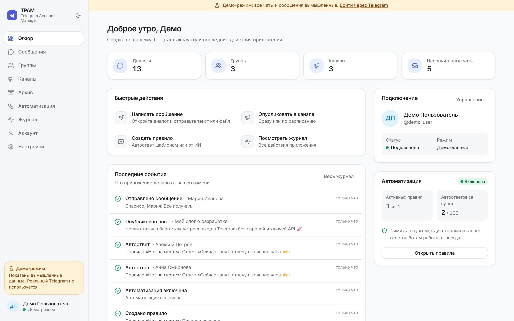

</div>

<br/>

> **TPAM** (Telegram Personal Account Manager) подключается к **личному** аккаунту Telegram как ещё одно устройство, например Telegram Desktop, через официальный протокол MTProto. Это не бот: всё работает от вашего имени, но только по вашим правилам.

---

## ✨ Возможности

<table>
<tr>
<td width="50%" valign="top">

### 🤖 Автоответы с ИИ
Ассистент понимает смысл сообщения и отвечает по вашей базе знаний (цены, график, частые вопросы). Он сам пропускает «спасибо», спам, разговоры о деньгах и личные темы. Работает на Claude от Anthropic, у каждого пользователя свой ключ.

</td>
<td width="50%" valign="top">

### 🗄 Архив удалённых сообщений
Каждое входящее сообщение сохраняется в момент получения. Если собеседник удалит или изменит его, у вас останется копия со всей историей правок. Удалённое видно прямо в чате.

</td>
</tr>
<tr>
<td valign="top">

### 💬 Переписка в браузере
Диалоги, группы и каналы, ответы на сообщения, отправка файлов, поиск по тексту всех чатов. Работает на компьютере и на телефоне, есть светлая и тёмная тема.

</td>
<td valign="top">

### 📣 Каналы и публикации
Публикация сразу или по расписанию: отложенный пост выходит силами самого Telegram, даже если TPAM выключен. Лента канала показывает просмотры и пересылки.

</td>
</tr>
<tr>
<td valign="top">

### ⚙️ Правила автоматизации
Срабатывают по ключевым словам, на любое сообщение или по регулярному выражению. Работают только в выбранных чатах. Новое правило сначала работает в тестовом режиме: только записывает в журнал, что ответило бы, ничего не отправляя.

</td>
<td valign="top">

### 🛡 Защита от блокировки
Паузы между ответами, лимиты в час и в сутки, запрет отвечать ботам и защита от бесконечных переписок двух автоответчиков. Если Telegram заподозрит спам, автоматизация сама встанет на паузу.

</td>
</tr>
<tr>
<td valign="top">

### 📥 Импорт истории
Прошлую переписку можно загрузить из официального экспорта Telegram Desktop. Дальше доступны мгновенный полнотекстовый поиск и выгрузка в CSV для Excel.

</td>
<td valign="top">

### 👥 Для одного или многих
Можно пользоваться одному на своём компьютере или запустить сайт для друзей и коллег. У каждого свои данные, а администратор управляет регистрацией.

</td>
</tr>
</table>

---

## 📸 Скриншоты

<table>
<tr>
<td width="50%">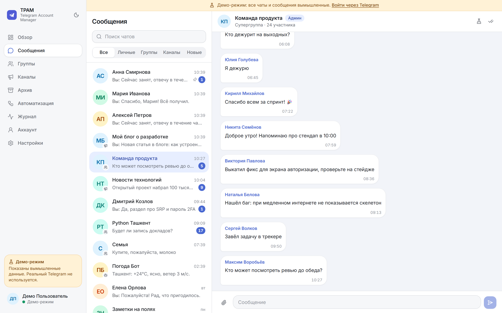<p align="center"><b>Сообщения</b>: диалоги, группы, каналы</p></td>
<td width="50%">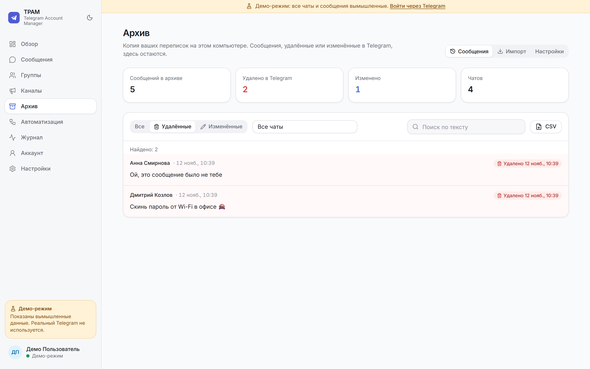<p align="center"><b>Архив</b>: удалённые и изменённые сообщения</p></td>
</tr>
<tr>
<td>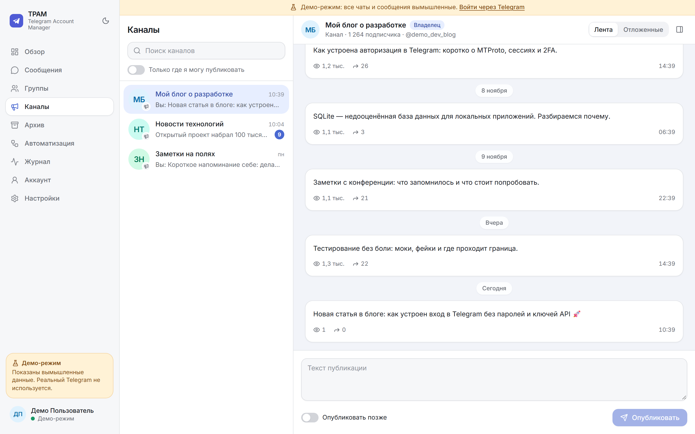<p align="center"><b>Каналы</b>: публикации со статистикой и по расписанию</p></td>
<td>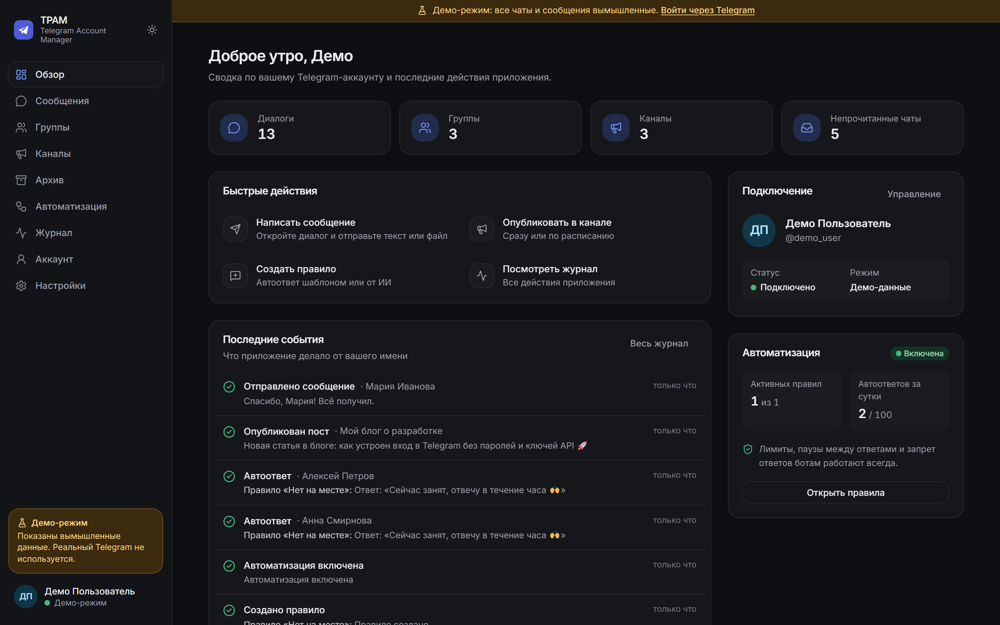<p align="center"><b>Тёмная тема</b></p></td>
</tr>
</table>

<details>
<summary><b>Ещё скриншоты</b>: автоматизация, журнал, вход, телефон</summary>
<br/>

| Автоматизация и ИИ | Журнал действий |
|---|---|
| 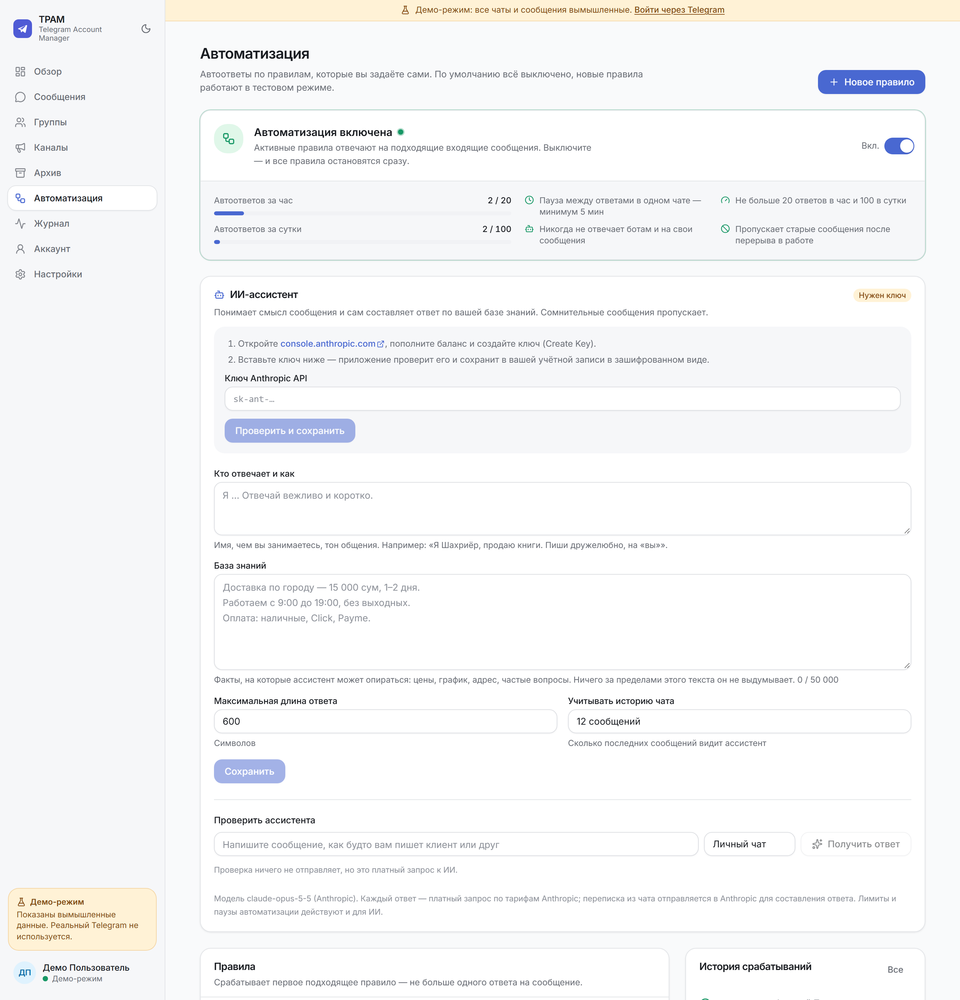 | 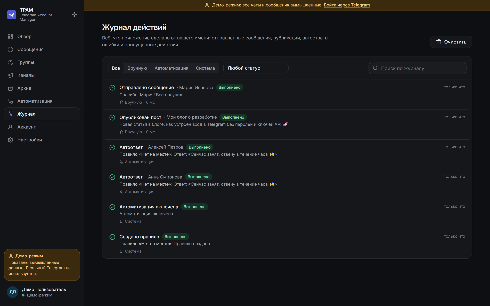 |

| Вход по номеру и коду | На телефоне |
|---|---|
| 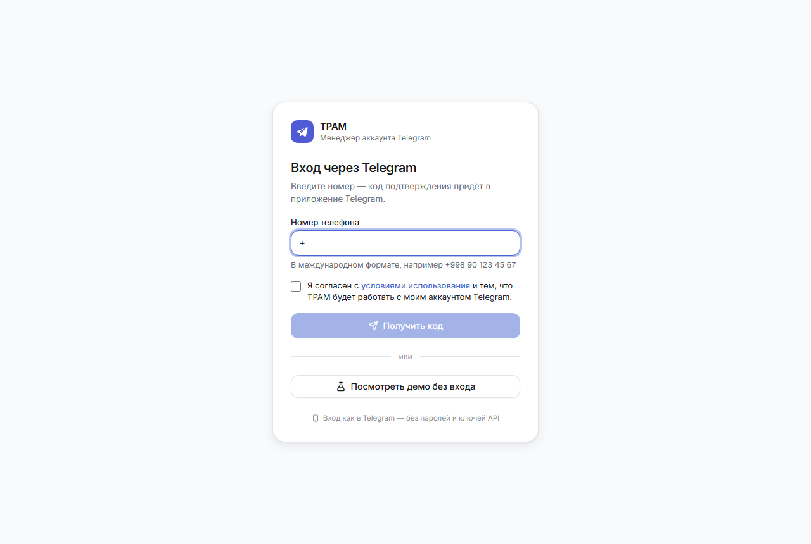 | 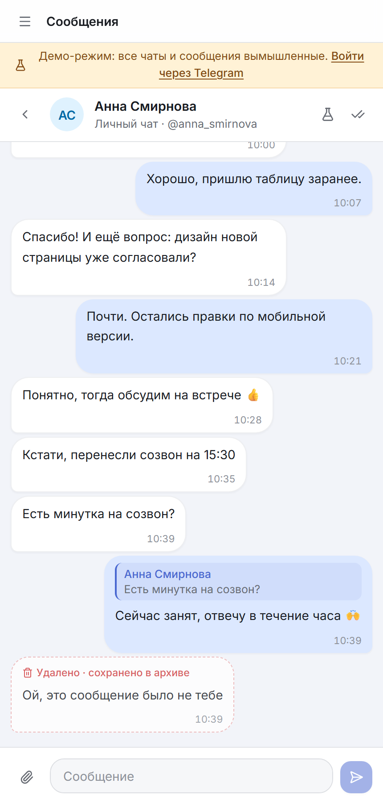 |

</details>

---

## 🚀 Быстрый старт

### Вариант 1. Посмотреть без входа
Откройте сайт и нажмите **«Посмотреть демо без входа»**. Откроются вымышленные чаты, на которых можно попробовать всё: автоответы, архив, публикации. Реальный Telegram при этом не используется.

### Вариант 2. На своём компьютере (Windows 11)

```powershell
# 1. Установите менеджер Python (uv) и Node.js, если их ещё нет
winget install --id astral-sh.uv -e
winget install --id OpenJS.NodeJS.LTS -e

# 2. Скачайте проект и запустите
git clone https://github.com/<ваш-аккаунт>/tpam.git
cd tpam
.\start.cmd
```

Первый запуск сам установит всё нужное и откроет `http://127.0.0.1:8765`. Python 3.13 скачается автоматически.

1. **Один раз** укажите API ID и API HASH приложения: сайт попросит их сам. Получить их можно на [my.telegram.org](https://my.telegram.org) → *API development tools*, [подробная инструкция](docs/CONNECT_TELEGRAM.md).
2. Войдите по номеру телефона и коду из Telegram. Первый вошедший становится администратором.

<details>
<summary><b>macOS / Linux</b></summary>

```bash
git clone https://github.com/<ваш-аккаунт>/tpam.git && cd tpam
(cd frontend && npm ci && npm run build)
cd backend && uv run tpam
```
</details>

### Вариант 3. Сайт для других людей (сервер + HTTPS)

```bash
cp .env.example .env      # домен, API ID / HASH, ключ шифрования
docker compose up -d --build
```

Caddy автоматически получит HTTPS-сертификат. Подробности и чек-лист безопасности — в **[docs/DEPLOY.md](docs/DEPLOY.md)**.

---

## 🔑 Как работает вход

Пользователи **не вводят никаких ключей API**: их один раз указывает владелец сервера. Вход устроен так же, как в официальном приложении Telegram:

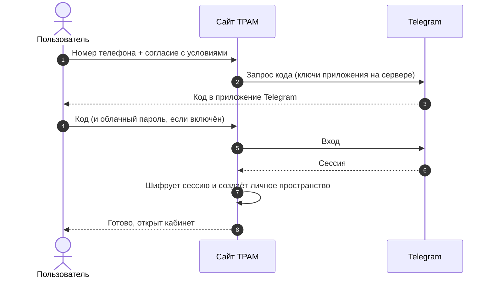

После входа TPAM виден в Telegram → *Настройки* → *Устройства* как «TPAM (веб-клиент)». Там же его можно отключить в любой момент.

---

## 🛡 Безопасность и приватность

| | |
|---|---|
| 🔒 **Шифрование** | Сессии Telegram и ключи ИИ хранятся зашифрованными (Fernet). Номер телефона хранится только в виде хэша и маски. |
| 🙈 **Ничего лишнего** | Код подтверждения и облачный пароль сразу уходят в Telegram и нигде не сохраняются. В логах секреты маскируются. |
| 🧱 **Изоляция** | У каждого пользователя отдельная папка и база данных: правила, журнал, архив. |
| 🚦 **Защита входа** | Не больше 3 запросов кода в час на номер и 10 в час с одного IP, по 5 попыток ввода кода и пароля. Регистрацию можно закрыть. |
| 🌐 **Веб-защита** | HttpOnly-cookie, защита от CSRF, проверка Host и Origin, CSP; на сервере — только HTTPS и HSTS. |
| 🧯 **Полный контроль** | Можно выйти на всех устройствах, отключить Telegram или удалить все свои данные одной кнопкой. |

**Чего TPAM намеренно не делает:** массовые рассылки и приглашения, обход ограничений Telegram (FloodWait, CAPTCHA, 2FA), подделка официального клиента, сохранение исчезающих фото и видео, секретные чаты.

---

## 🏗 Архитектура

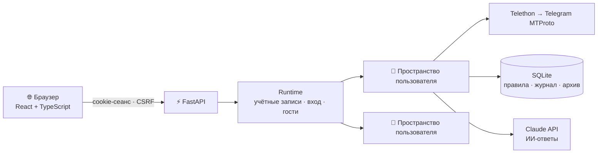

<details>
<summary><b>Технологии и структура проекта</b></summary>
<br/>

| Слой | Технологии |
|---|---|
| Backend | Python 3.13, FastAPI, Telethon (MTProto), SQLAlchemy 2 + aiosqlite, SQLite FTS5, Anthropic SDK, cryptography |
| Frontend | React 19, TypeScript, Vite, Tailwind CSS 4, компоненты в стиле shadcn/ui на Radix, TanStack Query, Lucide |
| Качество | pytest, Vitest + Testing Library, mypy `--strict`, ruff, oxlint |
| Запуск | uv, Docker, Caddy (HTTPS) |

```
tpam/
├── backend/src/tpam/
│   ├── accounts/     # учётные записи, вход по номеру и коду, лимиты попыток
│   ├── ai/           # ИИ-ассистент (Claude)
│   ├── archive/      # архив сообщений, импорт экспорта Telegram
│   ├── automation/   # движок правил и ограничители
│   ├── providers/    # Telegram (Telethon) и демо-данные
│   ├── storage/      # SQLite: журнал, правила, архив с полнотекстовым поиском
│   ├── api/          # маршруты, защита, определение пользователя
│   └── runtime.py    # пространства пользователей и гостей
├── frontend/src/
│   ├── pages/        # Обзор, Сообщения, Группы, Каналы, Архив, Автоматизация, Журнал…
│   ├── components/   # дизайн-система и компоненты чата
│   └── lib/          # API-клиент, запросы, тема, форматирование
├── docs/             # инструкции и скриншоты
├── Dockerfile · compose.yaml
└── start.cmd · dev.cmd
```
</details>

---

## ⚙️ Настройки сервера

Все параметры необязательны и задаются переменными окружения с префиксом `TPAM_` или в файле `.env`.

| Переменная | По умолчанию | Назначение |
|---|---|---|
| `TPAM_API_ID`, `TPAM_API_HASH` | — | Ключи приложения с my.telegram.org. Локально их можно ввести на сайте |
| `TPAM_SECRET_KEY` | создаётся сам | Ключ шифрования сессий. **Сохраните его** при переносе сервера |
| `TPAM_PUBLIC_URL` | — | Адрес сайта (`https://…`), обязателен для сервера |
| `TPAM_REGISTRATION_OPEN` | `true` | Разрешить регистрацию новых пользователей |
| `TPAM_MAX_USERS` | `200` | Лимит пользователей |
| `TPAM_MAX_GUESTS` | `50` | Одновременных демо-гостей (`0` — отключить демо) |
| `TPAM_PORT` | `8765` | Порт |
| `TPAM_DATA_DIR` | `%LOCALAPPDATA%\tpam` | Папка данных |

---

## 🧪 Разработка

```powershell
.\dev.cmd                       # backend + Vite с горячей перезагрузкой → http://localhost:5173

cd backend                      # 106 тестов, строгая типизация
uv run pytest
uv run ruff check src tests
uv run mypy src

cd frontend                     # 30 тестов
npm test
npx tsc -b
npm run lint
```

Тесты не обращаются к сети: Telegram и Anthropic заменены имитациями.

---

## ❓ FAQ

<details>
<summary><b>Это безопасно? Меня не заблокируют?</b></summary>

TPAM использует официальный протокол Telegram и представляется честно, как «TPAM (веб-клиент)». Блокируют обычно за спам, поэтому в TPAM встроены жёсткие лимиты, а функций массовой рассылки нет. Не используйте сервис для рекламных рассылок и не включайте автоответы на новом аккаунте, у которого ещё нет истории.
</details>

<details>
<summary><b>Зачем нужны API ID и API HASH и почему их не вводят пользователи?</b></summary>

Это «паспорт» приложения в Telegram: свой есть даже у официального Telegram Desktop. Владелец TPAM получает его один раз на my.telegram.org, а пользователи входят только по номеру и коду.
</details>

<details>
<summary><b>Видит ли владелец сервера мои сообщения?</b></summary>

Технически у владельца сервера есть доступ к серверу, поэтому используйте только тот TPAM, которому доверяете, или запустите собственный. Архив по умолчанию выключен: если вы его не включите, переписка на сервере не хранится. Сессия хранится в зашифрованном виде, и её можно завершить в Telegram → Устройства.
</details>

<details>
<summary><b>Сколько стоят ИИ-ответы?</b></summary>

Платите вы сами, по тарифам Anthropic, своим ключом. Ассистент вызывается только после проверки всех ограничений, поэтому пропущенные сообщения ничего не стоят. Начните с тестового режима: ответы будут видны в журнале, но не уйдут собеседникам.
</details>

<details>
<summary><b>Почему архив не сохранил сообщение, удалённое ночью?</b></summary>

Копия создаётся в момент получения, поэтому TPAM должен быть запущен. На своём компьютере включите «Запускать вместе с Windows» в настройках архива, а на сервере TPAM работает постоянно.
</details>

<details>
<summary><b>Можно ли сохранять секретные чаты или исчезающие фото?</b></summary>

Нет. Секретные чаты привязаны к конкретному устройству и недоступны другим программам. Исчезающие медиа TPAM не сохраняет намеренно, из уважения к отправителю.
</details>

---

## 🗺 Планы

- [ ] Просмотр и скачивание медиа прямо в чате
- [ ] Редактирование и удаление своих сообщений
- [ ] Повторяющиеся публикации (каждый день или неделю)
- [ ] Инструменты администратора групп: модерация, закреп, приглашения
- [ ] Вход по QR-коду

---

## ⚠️ Отказ от ответственности

TPAM — независимый проект, он не связан с Telegram FZ-LLC и не одобрен ею. Используя TPAM, вы обязуетесь соблюдать [условия использования Telegram API](https://core.telegram.org/api/terms) и законы вашей страны о персональных данных. Если вы запускаете сервис для других людей, вы отвечаете за их данные.

<div align="center">
<br/>

Сделано с ❤️ для тех, кто ценит своё время

</div>
