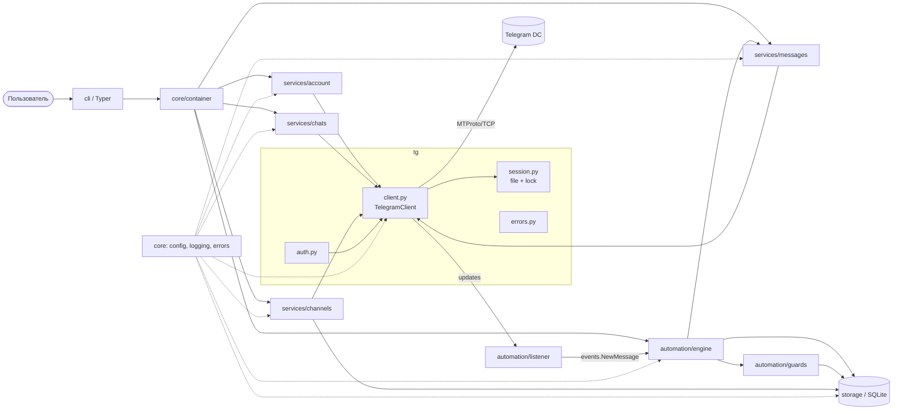
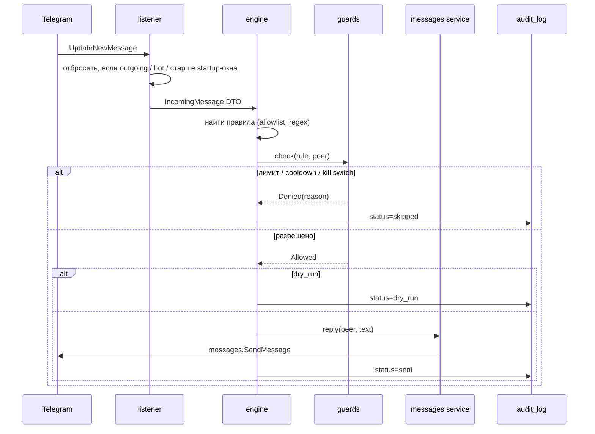
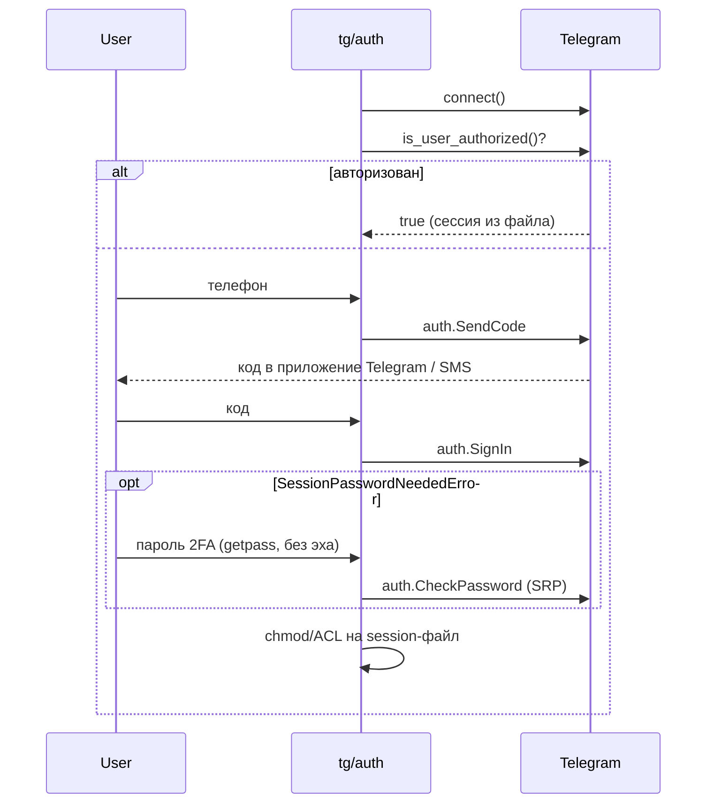

# Telegram Personal Account Manager (TPAM): технический план

> **Обновление (2026-11-11): MVP реализован как локальное веб-приложение.** По новому требованию «интерфейс — сайт» решения из §0 изменились:
> вместо CLI используется FastAPI (только 127.0.0.1, токен + проверка Host/Origin) + React-интерфейс; правила автоматизации хранятся в SQLite
> (редактор в UI), а не в YAML; API ID / API HASH — в Windows Credential Manager, а не в `.env`; добавлен демо-режим с отдельной базой.
> Актуальная структура и запуск — в [README.md](../README.md). Модель угроз (§8), ограничители (§8.3) и разделение «возможно / ограничено / невозможно» (§2.1) остаются в силе.
>
> Исходный статус: проектирование.
> Дата: 2026-11-11. Проверено по PyPI: Telethon **1.45.0** (сентябрь 2026). Ветка v1 находится в режиме поддержки (maintenance mode), а v2 до сих пор не вышла в стабильной версии.

---

## 0. Краткое резюме решений

| Вопрос | Решение для MVP | Почему |
|---|---|---|
| Язык | Python **3.12+** (CI на 3.12 и 3.13) | `TaskGroup`, `asyncio.timeout`, PEP 695, быстрее 3.11, поддержка до 10.2028, есть готовые сборки (wheels) `cryptg` |
| Клиент Telegram | Telethon 1.45 (`~=1.45`) | Зрелая и стабильная библиотека, хорошая документация. v2 пока не стабильна |
| Интерфейс | **CLI** (Typer) | Один пользователь, одна машина. HTTP-сервер не нужен |
| REST API (FastAPI) | Нет, переносится в v2 | Нужен только тогда, когда CLI должен управлять уже работающим демоном (см. §3.4) |
| Web Dashboard | Нет | Нет реальной потребности в MVP |
| БД | **SQLite** (SQLAlchemy 2.0 async + aiosqlite) | Один процесс, мало данных, не требует администрирования |
| PostgreSQL | Нет | Нужен только для нескольких аккаунтов или процессов |
| Docker | Опционально, этап 13 | Нужен для работы 24/7 на VPS. Для разработки на Windows не обязателен |
| Планирование публикаций | **Нативные отложенные сообщения Telegram** (`schedule=`) | Сервер Telegram сам публикует пост, даже если приложение выключено. Собственный планировщик не нужен |
| Правила автоматизации | YAML-файл + валидация через Pydantic | Явные правила, которые можно хранить в Git и проверять до запуска |
| Пакетный менеджер | `uv` | Быстрый, использует lock-файл и стандартный `pyproject.toml` |

---

## 1. Описание проекта

TPAM — это однопользовательское консольное приложение, которое подключается к **личному** Telegram-аккаунту через MTProto API (Mobile Transport Protocol — собственный бинарный протокол Telegram, на котором работают официальные клиенты; это не HTTP Bot API) с помощью Telethon. Приложение выступает ещё одним «устройством» аккаунта, как Telegram Desktop.

С его помощью можно:
- войти в аккаунт и восстанавливать сессию после перезапуска;
- читать и искать диалоги и сообщения, отправлять сообщения;
- получать информацию о группах и каналах, просматривать участников и выполнять админ-действия в пределах своих прав;
- публиковать посты в каналах, в том числе отложенные;
- запускать **контролируемую** автоматизацию: явно заданные правила автоответов со встроенными ограничителями и журналом аудита.

Чего TPAM **не делает** намеренно: массовых рассылок, массовых приглашений и парсинга чужих аудиторий, обхода FloodWait, CAPTCHA или 2FA, подделки официальных клиентов.

---

## 2. Требования

### 2.1. Что возможно, что ограничено правами и что невозможно

| Функция | Статус | Комментарий / API |
|---|---|---|
| Вход по телефону, коду и паролю 2FA | ✅ Возможно | `client.start()` / `sign_in()`. 2FA работает через SRP-проверку пароля, сам пароль не хранится |
| Вход по QR-коду | ✅ Возможно | `client.qr_login()`. Запланирован на v2 |
| Восстановление сессии | ✅ Возможно | `.session` (SQLite) или `StringSession` |
| Информация о себе | ✅ Возможно | `get_me()`, `users.GetFullUserRequest` |
| Список диалогов | ✅ Возможно | `iter_dialogs()` (есть архив и папки) |
| История сообщений | ✅ Возможно | `iter_messages()`. Только для чатов, где аккаунт состоит, и для публичных каналов |
| Поиск в чате | ✅ Возможно | `iter_messages(entity, search=..., from_user=..., filter=...)` |
| Глобальный поиск | ✅ Возможно | `iter_messages(None, search=...)` → `messages.SearchGlobalRequest` |
| Отправка, редактирование и удаление своих сообщений | ✅ Возможно | Редактировать можно только свои сообщения, удалять у всех — с учётом прав |
| Входящие сообщения в реальном времени | ✅ Возможно | `events.NewMessage`, `MessageEdited`, `MessageDeleted`, `ChatAction` |
| Секретные чаты | ❌ Невозможно | Сквозное шифрование привязано к устройству, и Telethon их не поддерживает |
| Чтение чатов, где аккаунт не состоит (приватных) | ❌ Невозможно | |
| Участники небольшой группы | ✅ Возможно | `get_participants()` |
| Участники супергруппы | ⚠️ Ограничено | Если включено «скрыть участников», список видят только админы. Для больших групп отдаётся ограниченная выборка |
| Подписчики канала | ⚠️ Только для админов | И тоже с ограничениями по объёму |
| Бан, ограничения, исключение из чата, назначение админов | ⚠️ Нужны права админа | `edit_permissions`, `kick_participant`, `edit_admin` |
| Название, описание, фото, закреп, инвайт-ссылки | ⚠️ Нужны права админа | `EditTitle`, `EditChatAbout`, `pin_message`, `ExportChatInvite` |
| Создание группы или канала | ✅ Возможно | `CreateChannelRequest(megagroup=...)` |
| Публикация в канал | ⚠️ Нужно право `post_messages` | |
| Отложенная публикация | ✅ Возможно | `send_message(..., schedule=datetime)`, не более **100** отложенных сообщений на чат |
| Статистика постов (просмотры, пересылки) | ✅ Возможно | Поля `views` и `forwards` у сообщений канала |
| Расширенная статистика канала | ⚠️ Ограничено | `stats.GetBroadcastStats`, только для админов крупных каналов |
| Массовая рассылка или приглашения | 🚫 Запрещено политикой | Аккаунт получает `PeerFloodError` и бан. **Не реализуется** |
| Обход FloodWait, CAPTCHA, 2FA | 🚫 Запрещено | **Не реализуется** |

### 2.2. Функциональные требования (FR)

**A. Аккаунт**
- FR-A1: команда `login` выполняет интерактивный вход: телефон → код → пароль 2FA (если включён).
- FR-A2: `whoami` показывает id, имя, @username, наличие Premium и номер телефона в замаскированном виде.
- FR-A3: `status` показывает, есть ли подключение, авторизован ли аккаунт, номер DC (дата-центр Telegram) и задержку.
- FR-A4: `logout` завершает сессию на сервере (`log_out()`) и удаляет локальный файл. Обычный выход из программы только отключается (`disconnect()`), и сессия сохраняется.
- FR-A5: после перезапуска приложение подключается без повторного ввода кода.

**B. Сообщения**
- FR-B1: `dialogs list` с фильтрами по типу (user, group, channel), непрочитанным и архиву, с лимитом.
- FR-B2: `messages history <peer>` с лимитом и параметрами offset / min_id.
- FR-B3: `messages send <peer> <text>` отправляет сообщение **одному** получателю. Дополнительно можно ответить на сообщение (reply) и прикрепить файл.
- FR-B4: `messages search` ищет внутри чата или глобально.
- FR-B5: `messages info <peer> <id>` показывает отправителя, дату, правки, пересылку и медиа.
- FR-B6: в режиме `run` входящие сообщения логируются и передаются движку автоматизации.

**C. Группы**
- FR-C1: список групп (обычные группы и супергруппы).
- FR-C2: информация о группе: название, описание, число участников, мои права.
- FR-C3: список участников в пределах доступных прав.
- FR-C4 (post-MVP): админ-операции — бан, ограничения, исключение, назначение админов, закреп, инвайт-ссылки.
- FR-C5: новые сообщения из выбранных групп поступают в обработчик (через FR-B6).

**D. Каналы**
- FR-D1: список каналов с отметкой, где у меня есть права админа или публикации.
- FR-D2: информация о канале.
- FR-D3: просмотр публикаций с полями views и forwards.
- FR-D4: публикация поста, если есть право `post_messages`. Перед отправкой права проверяются заранее.
- FR-D5: отложенная публикация `--at "2026-11-12 10:00"` через нативный механизм Telegram. Запись о посте сохраняется в БД.

**E. Автоматизация**
- FR-E1: правила задаются в `config/rules.yaml`: условие (chat / sender / regex / тип чата) → действие (reply / mark_read / log).
- FR-E2: у каждого правила есть явный allowlist чатов. Пустой allowlist допустим только в сочетании с `private_only: true`.
- FR-E3: ограничители обязательны (см. §10.3), их нельзя отключить через конфиг.
- FR-E4: режим `dry_run` включён по умолчанию для каждого нового правила.
- FR-E5: все действия, включая пропущенные и dry-run, записываются в `audit_log`.
- FR-E6: аварийный выключатель (kill switch): `AUTOMATION_ENABLED=false` или команда `automation pause`.

### 2.3. Нефункциональные требования (NFR)

| ID | Требование | Метрика |
|---|---|---|
| NFR-1 | Безопасность секретов | 0 секретов в Git и логах (проверяется gitleaks в pre-commit и CI) |
| NFR-2 | Надёжность | Автопереподключение. Демон без сбоев работает ≥ 72 ч |
| NFR-3 | Ресурсы | Простаивающий демон занимает ≤ 100 МБ RSS (resident set size — физическая память процесса) и почти не нагружает CPU |
| NFR-4 | Соблюдение лимитов | Ни одного повтора запроса раньше срока, указанного в FloodWait |
| NFR-5 | Наблюдаемость | Структурированные логи и аудит всех исходящих действий |
| NFR-6 | Качество | `mypy --strict`, `ruff` без ошибок, покрытие ≥ 80 % для `core`, `automation`, `storage` |
| NFR-7 | Переносимость | Windows 11 (разработка) и Linux (VPS / Docker) |
| NFR-8 | Единственный владелец сессии | Одну сессию одновременно использует только один процесс (это обеспечивает lock-файл) |

### 2.4. Неоднозначности и принятые решения

| # | Неоднозначность | Решение |
|---|---|---|
| 1 | Что входит в «управление группами» | В MVP только чтение. Админ-операции переносятся в v1.1. Массовые приглашения исключены полностью |
| 2 | Поиск: в одном чате или глобальный | Поддерживаются оба варианта (один API) |
| 3 | Планирование: свой планировщик или средства Telegram | Нативный `schedule=`. APScheduler появится только для повторяющихся публикаций в v2 |
| 4 | Хранить ли историю сообщений локально | **Нет**. Это лишние персональные данные и объём. Храним только аудит своих действий |
| 5 | Один аккаунт или несколько | Один. Конфиг уже сейчас содержит `SESSION_NAME`, чтобы позже расширить без переделок |
| 6 | Медиа | MVP: отправка файла. Скачивание медиа — в v1.1 |
| 7 | Где запускать демон | Локально на Windows. VPS + Docker — на этапе 13 |
| 8 | Как CLI взаимодействует с работающим демоном | В MVP никак: либо разовые команды, либо `run` (см. §3.4) |

---

## 3. Архитектура

### 3.1. Стиль

**Модульный монолит, 3 слоя.** Без DDD-агрегатов (Domain-Driven Design), без шины событий и без отдельного «repository на каждую таблицу ради принципа».

```
Interface (cli)  →  Services (account/messages/chats/channels/automation)  →  Infrastructure (telegram gateway, storage)
                                    ↑
                               core (config, logging, errors) — используется всеми
```

Ключевое решение: **сервисы являются антикоррупционным слоем** (anti-corruption layer — слой, который не пускает чужую модель данных в ваш код). Они вызывают `TelegramClient` и возвращают собственные DTO (`dataclass(frozen=True, slots=True)`), а не объекты Telethon. В результате:
- CLI, storage и автоматизация не зависят от Telethon;
- при переходе на Telethon v2 или другую библиотеку меняются только `telegram/` и `services/`;
- отдельный интерфейс `TelegramGateway` поверх `TelegramClient` **не вводится**: это был бы второй слой, который просто повторяет API. Сервисы тестируются через `AsyncMock(spec=TelegramClient)`.

### 3.2. Корректировки предложенного разделения модулей

| Предложено | Решение | Причина |
|---|---|---|
| `logging` | → `core/logging.py` | Пакет верхнего уровня с именем `logging` перекрывает стандартную библиотеку |
| `telegram` | → `tg/` | Имя `telegram` занято пакетом python-telegram-bot, это источник конфликтов импорта |
| `account`, `messages`, `chats`, `channels` | → файлы внутри `services/` | В каждом по 100–300 строк, отдельный пакет не нужен |
| `scheduler` | Отдельного модуля нет. Отложенные посты реализованы в `services/channels.py` + `storage` | Публикацию выполняет Telegram, а не наш код |
| `storage` | Оставлен | |
| `automation` | Оставлен | Самая сложная бизнес-логика |
| `tests` | Оставлен, расположен вне `src/` | |
| — | **Добавлен** `cli/` | Интерфейс |
| — | **Добавлен** `domain/models.py` | DTO, общие для всех слоёв |

### 3.3. Ответственность компонентов

| Компонент | Ответственность | Зависит от |
|---|---|---|
| `core/config.py` | `Settings` (pydantic-settings): `.env`, `SecretStr`, валидация, пути | — |
| `core/logging.py` | Настройка stdlib logging, JSON- или консольный формат, **фильтр маскирования** секретов | config |
| `core/errors.py` | Иерархия доменных исключений (`TpamError` → `AuthError`, `RateLimited`, `PermissionDenied`, `NotFound`, `SafetyLimitExceeded`) | — |
| `core/container.py` | Composition root (единственное место, где создаются и связываются все объекты): ручной DI без фреймворка | всё |
| `tg/client.py` | Фабрика `TelegramClient`: параметры устройства, переподключение, `flood_sleep_threshold`, async-контекстный менеджер жизненного цикла | config, session |
| `tg/session.py` | Путь к сессии, права на файл (ACL — Access Control List, список прав доступа в Windows / `chmod 600`), **lock-файл единственного владельца** | config |
| `tg/auth.py` | Интерактивный вход: колбэки для телефона, кода и пароля 2FA, обработка ошибок авторизации | client |
| `tg/errors.py` | Перевод `telethon.errors.RPCError` в `core.errors` (декоратор / контекстный менеджер) | core.errors |
| `services/account.py` | whoami, status, logout | tg |
| `services/messages.py` | диалоги, история, отправка, поиск, информация | tg, domain |
| `services/chats.py` | группы, информация, участники, (v1.1) админ-операции | tg, domain |
| `services/channels.py` | каналы, посты, публикация, отложенная публикация | tg, storage, domain |
| `automation/rules.py` | Pydantic-модели правил и загрузчик YAML | — |
| `automation/guards.py` | Ограничители: rate limit, cooldown, дневной лимит, kill switch | storage |
| `automation/engine.py` | Сопоставление события с правилами → проверка ограничителями → действие → аудит | rules, guards, services, storage |
| `automation/listener.py` | Регистрация обработчиков `events.*` на клиенте, фильтр «старых» событий | tg, engine |
| `storage/db.py` | Engine и фабрика сессий SQLAlchemy, `create_all` | config |
| `storage/models.py` | ORM-таблицы (§3.6) | — |
| `storage/repositories.py` | `AuditRepository`, `RuleStateRepository`, `ScheduledPostRepository` | db, models |
| `cli/` | Команды Typer, вывод через Rich, `asyncio.run` для каждой команды | container |

### 3.4. Процессная модель и владение сессией

- **Один процесс — одна сессия.** Если одной и той же auth key (ключ авторизации внутри файла сессии) одновременно пользуются с разных IP-адресов, Telegram отвечает `AuthKeyDuplicatedError` и **аннулирует сессию**. Даже на одной машине два процесса с одним `.session` (SQLite) ловят ошибку `database is locked`.
- Поэтому `tg/session.py` захватывает `data/<name>.lock` (эксклюзивную блокировку файла). Вторая команда при запущенном `run` завершится понятной ошибкой: «сессия занята демоном».
- В MVP это допустимо: команды либо разовые, либо работает демон `run`.
- В v2 демон поднимает **локальный** FastAPI на `127.0.0.1` с токеном, а CLI превращается в HTTP-клиента. Это и есть настоящая причина добавить FastAPI, а не «потому что так принято».

### 3.5. Схема взаимодействия компонентов



**Обработка входящего сообщения:**



**Вход в аккаунт:**



### 3.6. Модель данных (SQLite)

| Таблица | Поля | Назначение |
|---|---|---|
| `audit_log` | id, ts (UTC), action, peer_id, rule_id?, status (`sent`/`dry_run`/`skipped`/`failed`), reason, error_code, text_preview (≤ 64 символов, опционально) | Аудит всех исходящих действий |
| `rule_state` | rule_id, peer_id, last_fired_at, fired_today, day | Cooldown и дневные лимиты. Состояние сохраняется после перезапуска |
| `scheduled_posts` | id, peer_id, tg_message_id, scheduled_at (UTC), status, created_at | Учёт отложенных постов, чтобы их можно было посмотреть или отменить |

Отдельная БД `data/tpam.db` **не смешивается** с `data/<name>.session` (файлом сессии Telethon).

---

## 4. Структура директорий

```
telegram-profile/
├── pyproject.toml              # зависимости, ruff, mypy, pytest
├── uv.lock
├── .env.example                # шаблон без значений
├── .gitignore                  # .env, data/, *.session, *.session-journal, logs/
├── .pre-commit-config.yaml     # ruff, mypy, gitleaks
├── README.md
├── docs/
│   └── PLAN.md                 # этот документ
├── config/
│   └── rules.example.yaml
├── data/                       # (gitignored) session, lock, tpam.db
├── logs/                       # (gitignored)
├── src/tpam/
│   ├── __init__.py
│   ├── __main__.py             # python -m tpam
│   ├── core/
│   │   ├── config.py
│   │   ├── logging.py
│   │   ├── errors.py
│   │   └── container.py
│   ├── domain/
│   │   └── models.py           # UserInfo, DialogInfo, MessageInfo, ChatInfo, ChannelInfo, Participant
│   ├── tg/
│   │   ├── client.py
│   │   ├── session.py
│   │   ├── auth.py
│   │   └── errors.py
│   ├── services/
│   │   ├── account.py
│   │   ├── messages.py
│   │   ├── chats.py
│   │   └── channels.py
│   ├── automation/
│   │   ├── rules.py
│   │   ├── guards.py
│   │   ├── engine.py
│   │   └── listener.py
│   ├── storage/
│   │   ├── db.py
│   │   ├── models.py
│   │   └── repositories.py
│   └── cli/
│       ├── app.py              # корневой Typer, общий --json вывод
│       ├── account.py
│       ├── messages.py
│       ├── chats.py
│       ├── channels.py
│       └── automation.py       # run, rules validate, pause/resume, audit
└── tests/
    ├── conftest.py
    ├── unit/
    ├── integration/
    └── e2e/                    # ручной запуск, тестовые DC Telegram
```

Используется src-layout: каталог `src/` не даёт случайно импортировать неустановленный пакет и сразу выявляет ошибки упаковки.

---

## 5. Технологии и зависимости

| Пакет | Роль | Обоснование |
|---|---|---|
| `telethon~=1.45` | MTProto-клиент | Стабильная ветка, полный доступ к raw API (`functions.*`) |
| `cryptg` | Ускорение AES | Нативная реализация AES вместо чистого Python: меньше нагрузка на CPU при работе с медиа. Если wheel нет, Telethon работает и без него |
| `pydantic-settings` | Конфигурация из `.env` | `SecretStr`, типизация, понятные ошибки при старте |
| `pydantic` (v2) | Валидация правил | Тот же инструмент, что и для конфига |
| `pyyaml` | Чтение `rules.yaml` | Только `safe_load` |
| `typer` (+ `rich`) | CLI | Подкоманды на type hints, удобный вывод |
| `sqlalchemy[asyncio]~=2.0` + `aiosqlite` | Хранилище | Async, переход на PostgreSQL сводится к смене URL |
| — | Логирование | stdlib `logging` + свой JSON-formatter, без structlog |
| **dev:** `pytest`, `pytest-asyncio`, `pytest-cov`, `ruff`, `mypy`, `pre-commit`, `gitleaks` | Качество | |

**Сознательно не используются в MVP:** FastAPI, Celery, Redis, APScheduler, Alembic (пока одна схема и `create_all` достаточно; Alembic подключается вместе с первой миграцией или PostgreSQL), DI-фреймворки (`dependency-injector`), structlog.

---

## 6. Roadmap по этапам

Формат каждого этапа: **Цель / Задачи / Файлы / Технологии / Зависимости / DoD (Definition of Done — критерии готовности) / Риски**.

### Этап 1. Анализ требований и проектирование
- **Цель:** утвердить объём MVP и архитектуру.
- **Задачи:** согласовать §2.4, получить `api_id` и `api_hash` на my.telegram.org, включить 2FA на аккаунте.
- **Файлы:** `docs/PLAN.md`, `README.md`.
- **Зависимости:** —
- **DoD:** решения в §0 и §2.4 утверждены, `api_id` получен.
- **Риски:** my.telegram.org иногда отказывает в создании приложения (ошибка «ERROR» на форме). Обычно помогает другой браузер или отключение VPN и блокировщиков рекламы.

### Этап 2. Настройка проекта
- **Цель:** воспроизводимое окружение и проверки качества.
- **Задачи:** `uv init --package`, `pyproject.toml`, `ruff`, `mypy --strict`, pytest, pre-commit с gitleaks, `.gitignore`, `.env.example`, `core/config.py`, `core/logging.py` с фильтром маскирования, `git init`.
- **Файлы:** `pyproject.toml`, `.pre-commit-config.yaml`, `.gitignore`, `.env.example`, `src/tpam/core/{config,logging,errors}.py`.
- **Технологии:** uv, pydantic-settings, ruff, mypy.
- **Зависимости:** 1.
- **DoD:** `uv run tpam --help` работает. Без `.env` приложение падает с понятной ошибкой валидации. Тест подтверждает, что `api_hash` и телефон маскируются в логах. Pre-commit блокирует коммит с тестовым секретом.
- **Риски:** под Windows может не найтись wheel для `cryptg` → сделать его опциональной зависимостью (extra).

### Этап 3. Подключение к MTProto
- **Цель:** надёжное соединение и управляемый жизненный цикл.
- **Задачи:** фабрика клиента (`device_model="TPAM"`, `app_version`, `system_version` — честные значения, видны в «Активных сеансах»), `connection_retries`, `auto_reconnect=True`, `flood_sleep_threshold=60`, `async with` для гарантированного `disconnect()`. Lock-файл единственного владельца. Логи Telethon — на уровне WARNING.
- **Файлы:** `tg/client.py`, `tg/session.py`.
- **Зависимости:** 2.
- **DoD:** команда `tpam status` подключается и показывает DC и `is_user_authorized=False`. Второй параллельный запуск завершается с понятной ошибкой «сессия занята».
- **Риски:** на Windows `loop.add_signal_handler` **не поддерживается** → корректное завершение делается через `try/finally` + `KeyboardInterrupt`, а не через обработчики сигналов.

### Этап 4. Авторизация и управление сессией
- **Цель:** безопасный вход и восстановление сессии.
- **Задачи:** `login`, где телефон вводится в prompt (или берётся из `.env`), код и пароль 2FA — через `getpass`. Обработка ошибок `PhoneNumberInvalid`, `PhoneCodeInvalid` (повторный ввод, ≤ 3 попытки), `PhoneCodeExpired`, `SessionPasswordNeeded`, `PasswordHashInvalid`, `FloodWait` (показать время ожидания и выйти, **без** повторных попыток), `PhoneNumberBanned`. При старте обрабатываются `AuthKeyUnregistered` / `SessionRevoked` с подсказкой «выполните `tpam login`». После входа файлу сессии выставляются права. `logout` = `log_out()` + удаление файла.
- **Файлы:** `tg/auth.py`, `tg/errors.py`, `cli/account.py`.
- **Зависимости:** 3.
- **DoD:** вход с 2FA работает. После перезапуска код не запрашивается. После `logout` сессия исчезает из списка «Устройства» в Telegram. Код и пароль не попадают ни в логи, ни в историю shell.
- **Риски:** (1) если переслать код входа в любой чат Telegram, Telegram аннулирует этот код (так устроена защита) → в документации предупредить «никому не пересылайте код». (2) В первые 24 часа после входа новая сессия не может завершать другие сессии (`FreshResetAuthorisationForbidden`) — это нормальное поведение. (3) Для новых аккаунтов вход через сторонний `api_id` повышает риск бана → использовать аккаунт с историей.

### Этап 5. Account Management
- **Цель:** FR-A2…A5.
- **Задачи:** `AccountService.whoami()` → `UserInfo`, `status()`, маскирование телефона (`+998*****12`).
- **Файлы:** `services/account.py`, `domain/models.py`, `cli/account.py`.
- **Зависимости:** 4.
- **DoD:** `whoami` и `status` работают, есть вывод `--json`. Unit-тесты с `AsyncMock`.
- **Риски:** минимальные.

### Этап 6. Messages Management
- **Цель:** FR-B1…B6.
- **Задачи:** `iter_dialogs` с фильтрами, `iter_messages` с пагинацией, `send_message` (один получатель, лимит длины 4096 символов → понятная ошибка или явный `--split`), поиск в чате и глобальный, `info`. Разрешение peer по `@username` / id / ссылке t.me.
- **Файлы:** `services/messages.py`, `cli/messages.py`.
- **Зависимости:** 5.
- **DoD:** все команды работают на реальном аккаунте. Ошибки `ChatWriteForbidden`, `UserPrivacyRestricted`, `UsernameNotOccupied` выводятся понятным текстом.
- **Риски:** **кэш сущностей (entity cache).** Пользователя по одному числовому id можно получить, только если клиент его уже «видел» (нужен `access_hash`). Решение: принимать `@username`, а при первом запуске прогревать кэш через `get_dialogs()`. Частые `ResolveUsername` упираются в FloodWait → использовать кэш сессии.

### Этап 7. Chats & Groups
- **Цель:** FR-C1…C3, C5 (C4 — в v1.1).
- **Задачи:** отделить обычные группы (`Chat`) от супергрупп (`Channel.megagroup=True`). `ChatInfo` с моими правами (`get_permissions`). Участники с лимитом и поиском.
- **Файлы:** `services/chats.py`, `cli/chats.py`.
- **Зависимости:** 6.
- **DoD:** участники выводятся там, где это разрешено. Где не разрешено — приходит `PermissionDenied` с причиной, а не stacktrace.
- **Риски:** супергруппы технически являются каналами, это частая путаница. Для больших групп список участников неполный по ограничениям Telegram — это не баг.

### Этап 8. Channels Management
- **Цель:** FR-D1…D5.
- **Задачи:** список каналов с флагами `is_admin` и `can_post`, информация, посты (`views`, `forwards`), `publish` с предварительной проверкой прав, `publish --at` → `schedule=`, запись в `scheduled_posts`, `scheduled list/cancel` (`messages.GetScheduledHistory` / `DeleteScheduledMessages`).
- **Файлы:** `services/channels.py`, `cli/channels.py`, `storage/*` (минимально).
- **Зависимости:** 7, частично 10 (таблица `scheduled_posts`; можно сделать раньше).
- **DoD:** отложенный пост появляется в списке отложенных в официальном приложении и публикуется в назначенное время при **выключенном** TPAM.
- **Риски:** часовые пояса → внутри всё хранится в UTC, вводить время можно в локальной зоне (`zoneinfo`). Лимит — 100 отложенных сообщений на чат.

### Этап 9. Automation
- **Цель:** FR-E1…E6 с безопасностью по умолчанию.
- **Задачи:** схема правил, загрузка и валидация (`tpam rules validate`), listener с фильтрами, engine, guards (§10.3), dry-run, аудит, `tpam run` (демон), `automation pause/resume`.
- **Файлы:** `automation/*`, `cli/automation.py`, `config/rules.example.yaml`.
- **Зависимости:** 6, 10.
- **DoD:** правило в dry-run пишет в аудит и ничего не отправляет. Боевое правило отвечает один раз за cooldown. Превышение лимита → `skipped` в аудите. Два TPAM-аккаунта, отвечающие друг другу, не входят в бесконечный цикл. Тесты engine и guards покрывают ≥ 90 % кода.
- **Риски:** (1) `catch_up=True` после простоя доставляет старые сообщения, и на них сработают автоответы → игнорировать сообщения старше `startup_time - N минут`. (2) Петли между ботами и автоответчиками → не отвечать ботам, не отвечать на свои исходящие, cooldown на каждый peer. (3) Telegram Business (Premium) уже умеет нативные away-сообщения — для простых сценариев их стоит рассмотреть как альтернативу.

```yaml
# config/rules.example.yaml
rules:
  - id: away-private
    enabled: true
    dry_run: true                # по умолчанию
    match:
      private_only: true
      chats: []                  # пусто допустимо только с private_only
      regex: "(?i)\\b(привет|hello)\\b"
      ignore_bots: true          # нельзя выключить
    action:
      type: reply
      text: "Сейчас не в сети, отвечу позже."
    limits:
      cooldown_per_peer: 6h
      max_per_day: 30
```

### Этап 10. Хранение данных и планировщик
- **Цель:** персистентность аудита, состояния правил и отложенных постов.
- **Задачи:** `storage/db.py` (WAL — write-ahead log, режим журнала SQLite, при котором чтение не блокирует запись), модели, три репозитория, ретенция аудита (команда `audit prune --older-than 90d`). «Планировщик» = нативное отложенное сообщение плюс сверка статусов (`scheduled sync` сравнивает `scheduled_posts` с `GetScheduledHistory`).
- **Файлы:** `storage/*`.
- **Зависимости:** 2. Этот этап можно делать **параллельно** с 5–8.
- **DoD:** интеграционные тесты на временной SQLite. Состояние cooldown сохраняется после перезапуска.
- **Риски:** блокировки SQLite → один engine на процесс, короткие транзакции.

### Этап 11. Безопасность и обработка ошибок
- **Цель:** единая модель ошибок и проверка безопасности.
- **Задачи:** полная таблица соответствия RPC-ошибок (§10.2), глобальный обработчик в CLI (exit codes: 1 — ошибка пользователя, 2 — авторизация, 3 — rate limit, 4 — права), проверка прав файла сессии при старте (если права слишком широкие — warning или отказ), обзор логов на утечки, `pip-audit`.
- **Файлы:** `tg/errors.py`, `core/errors.py`, `cli/app.py`, `tg/session.py`.
- **Зависимости:** 4–9. Базовая часть закладывается ещё на этапе 2.
- **DoD:** чек-лист §10.4 пройден, `pip-audit` чистый, gitleaks чистый.
- **Риски:** stacktrace из `RPCError` может содержать параметры запроса (включая текст сообщения) → не логировать `repr(request)` на уровне INFO.

### Этап 12. Тестирование
- См. §7. Тесты пишутся **на каждом этапе**, а этап 12 — это добор покрытия, e2e на тестовых DC и CI.
- **DoD:** CI (GitHub Actions: ruff, mypy, pytest, gitleaks) зелёный, покрытие соответствует NFR-6.

### Этап 13. Docker и запуск
- **Цель:** демон 24/7 на VPS.
- **Задачи:** multi-stage `Dockerfile` (`python:3.12-slim`, non-root UID), `compose.yaml` с volume `./data` (права 700), `restart: unless-stopped`, healthcheck (`tpam status --quiet`), отдача `.env` через `env_file` и Docker secrets. **Вход выполняется один раз интерактивно** (`docker compose run --rm tpam login`), потом запускается `up -d`.
- **Зависимости:** 9–12.
- **DoD:** контейнер переживает перезапуск хоста без повторного ввода кода. Процесс в контейнере работает не от root.
- **Риски:** если вход выполнен с одного IP, а сессия используется с другого (VPS), Telegram может прислать уведомление о новом входе — это нормально. **Нельзя** параллельно запускать ту же сессию локально (`AuthKeyDuplicated`).

### Этап 14. Документация
- **Задачи:** README (установка, получение `api_id`, вход, команды, безопасность), `docs/rules.md` (схема правил), `docs/security.md` (что делать при утечке сессии), docstrings у публичных сервисов, `CHANGELOG.md`.
- **DoD:** человек без контекста за 15 минут выполняет вход и `whoami`, пользуясь только README.

**Критический путь:** 2 → 3 → 4 → 5 → 6 → 9 → 13. Этапы 7, 8 и 10 можно делать параллельно после 6 (10 — уже после 2).

---

## 7. План тестирования

| Уровень | Что | Как | Где |
|---|---|---|---|
| Unit | config, маскирование логов, соответствие ошибок, правила (regex, allowlist), guards (cooldown, лимиты, kill switch), маппинг DTO | pytest, `AsyncMock(spec=TelegramClient)`, фиктивные часы (`now()` инъектируется) | CI |
| Integration | репозитории, engine + guards + storage вместе, CLI через `typer.testing.CliRunner` с подменённым контейнером | временная SQLite (`tmp_path`) | CI |
| E2E | вход, отправка, поиск, отложенный пост, автоответ | **Тестовые DC Telegram**: `client.session.set_dc(2, '149.154.167.40', 443)`, номер вида `99966XYYYY` (X — номер DC), код — X, повторённый 5 раз | вручную / по метке, **не** в CI |
| Безопасность | gitleaks, `pip-audit`, тест «секрет не попал в лог» | pre-commit + CI | CI |
| Нагрузочные / soak (длительный прогон) | демон 72 ч, память, переподключения | вручную, этап 13 | VPS |

Принципы:
- **Никогда** не запускать тесты против реального аккаунта в CI: секреты сессии не должны попадать в CI.
- Безопасность автоматизации проверяется тестами в первую очередь: петли, старые сообщения, сообщения от ботов, превышение лимитов, dry-run.
- В тестовых DC другие данные и иногда бывает нестабильность. Сбой e2e там — сигнал, а не блокер.

---

## 8. Риски и безопасность

### 8.1. Модель угроз

| Угроза | Последствие | Мера |
|---|---|---|
| Утечка файла `.session` | **Полный доступ к аккаунту без кода и без 2FA** (2FA защищает только новый вход, а не уже авторизованную сессию) | Права 600 / ACL только для текущего пользователя, `data/` в `.gitignore`, не лежит в облачных папках (OneDrive Desktop sync!), процедура отзыва: Telegram → Настройки → Устройства → завершить сеанс «TPAM» |
| Утечка `api_hash` | Злоумышленник может создать клиент от имени вашего приложения. Без сессии доступа к аккаунту это не даёт | `.env` в `.gitignore`, `SecretStr`, gitleaks |
| Секреты в логах | Утечка через логи и баг-репорты | Фильтр маскирования, текст сообщений только на DEBUG и только при явном флаге |
| Бан аккаунта за спам | Потеря аккаунта | Guards, отсутствие функций рассылки, аудит |
| Перехват кода входа | Захват аккаунта | Код вводится только в prompt, никогда не пересылается. Включена 2FA |
| `AuthKeyDuplicated` | Сессия аннулирована | Lock-файл, один процесс |
| Telethon v1 в maintenance-режиме | Отставание от новых слоёв API | Изоляция в `tg/` + `services/`. Отслеживать релизы |
| Зависимости с CVE | Компрометация | `uv.lock`, `pip-audit`, Dependabot |

**Ловушка Windows:** `C:\Users\User\Desktop` часто синхронизируется с OneDrive. Если включена «Резервная копия рабочего стола», файл сессии окажется в облаке. Рекомендуется указать `SESSION_DIR=%LOCALAPPDATA%\tpam` или убедиться, что синхронизация выключена.

### 8.2. Соответствие ошибок Telegram

| Telethon | Доменное исключение | Поведение |
|---|---|---|
| `FloodWaitError(seconds)` | `RateLimited(seconds)` | Если ≤ threshold, Telethon сам подождёт. Если больше — выход или пауза автоматизации. **Не повторять раньше срока** |
| `SlowModeWaitError` | `RateLimited` | То же |
| `PeerFloodError` | `RateLimited(spam=True)` | **Немедленная пауза** всей автоматизации и предупреждение: Telegram считает действия спамом |
| `ChatAdminRequiredError`, `ChatWriteForbiddenError`, `UserPrivacyRestrictedError`, `ChannelPrivateError` | `PermissionDenied` | Сообщение с причиной |
| `UsernameNotOccupiedError`, `UsernameInvalidError`, `ValueError` при поиске сущности | `NotFound` | |
| `AuthKeyUnregisteredError`, `SessionRevokedError`, `UserDeactivatedBanError` | `AuthError(session_invalid)` | Подсказка выполнить `tpam login` / проверить статус аккаунта |
| `SessionPasswordNeededError` | обрабатывается в `auth.py` | Запрос пароля |
| `ConnectionError`, `asyncio.TimeoutError` | `NetworkError` | Telethon переподключается сам. Для разовых команд — понятная ошибка |

### 8.3. Ограничители автоматизации (зашиты в код, а не в конфиг)

1. Отвечать только на **входящие** сообщения (`event.out == False`) и **никогда** ботам.
2. Игнорировать сообщения старше «окна старта» (по умолчанию 2 мин до запуска).
3. Явный allowlist чатов. Группы и каналы — только если они перечислены явно.
4. Cooldown на каждую пару (правило, peer). По умолчанию ≥ 1 ч, меньше 5 мин задать нельзя.
5. Глобальный лимит: ≤ 20 автодействий в час и ≤ 100 в сутки (настраивается **только вниз**).
6. При `PeerFloodError` или FloodWait дольше 5 минут автоматизация ставится на паузу, и это записывается в аудит.
7. Dry-run по умолчанию. Kill switch через env и команду.
8. В CLI нет команды «отправить всем», «по списку» или «пригласить список» — **намеренно**.

### 8.4. Чек-лист безопасности (DoD этапа 11)
- [ ] `.env`, `data/`, `*.session*`, `logs/` есть в `.gitignore`. Gitleaks в pre-commit и CI.
- [ ] `api_hash` хранится как `SecretStr`, в `repr` и логах — `**********`.
- [ ] Телефон в логах маскируется. Код и пароль никогда не логируются и не сохраняются.
- [ ] Права на файл сессии проверяются при старте.
- [ ] Lock-файл защищает от параллельного запуска.
- [ ] `logout` отзывает сессию на сервере.
- [ ] Логи Telethon — на уровне WARNING. Нет `repr(request)` на INFO.
- [ ] `pip-audit` чистый.
- [ ] README описывает процедуру действий при утечке сессии.

---

## 9. MVP и будущие версии

| Версия | Функции |
|---|---|
| **MVP (v1.0)** | login/logout/whoami/status · диалоги, история, отправка (текст + файл), поиск, информация о сообщении · список групп, информация, участники (чтение) · список каналов, информация, посты, публикация, отложенная публикация · `run` + автоответы с guards, dry-run, аудит · SQLite · CLI |
| v1.1 | Админ-операции в группах (бан, ограничения, закреп, инвайт-ссылки) · редактирование и удаление сообщений · скачивание медиа · экспорт аудита в CSV |
| v2.0 | Вход по QR · шифрование сессии ключом из системного хранилища (`keyring` → Windows Credential Manager) · локальный FastAPI-демон + CLI как клиент · повторяющиеся публикации (APScheduler) · Alembic · Docker на VPS как основной сценарий |
| v3.0 (по потребности) | Web dashboard · несколько аккаунтов · PostgreSQL · метрики Prometheus |

---

## 10. Критерии готовности проекта (MVP)

1. Выполнены все FR из §2.2 с пометкой MVP.
2. NFR-1…NFR-8 подтверждены (метрики из §2.3).
3. Чек-лист безопасности §8.4 закрыт.
4. CI зелёный: ruff, `mypy --strict`, pytest (покрытие ≥ 80 % для core, automation, storage), gitleaks, pip-audit.
5. E2E-сценарии на тестовых DC прошли вручную, протокол приложен.
6. Демон проработал 72 ч на реальном аккаунте в dry-run и 24 ч в боевом режиме без FloodWait > 60 с и без предупреждений о спаме.
7. По README новый пользователь самостоятельно выполняет вход за ≤ 15 минут.

---

## 11. Термины

- **MTProto** — собственный протокол Telegram для клиентов (шифрование + RPC), отличается от HTTP Bot API.
- **DC (Data Center)** — дата-центр Telegram. За каждым аккаунтом закреплён «домашний» DC.
- **Session / auth key** — ключ авторизации устройства. Владение им равно владению аккаунтом.
- **access_hash** — значение, которое нужно знать вместе с id пользователя или канала, чтобы к нему обращаться. Приходит с сервера, хранится в кэше сессии.
- **FloodWait** — ответ сервера «подождите N секунд», это rate limit.
- **PeerFlood** — сигнал Telegram, что аккаунт рассылает слишком много сообщений незнакомым пользователям (подозрение на спам).
- **Megagroup / супергруппа** — группа, технически устроенная как канал.
